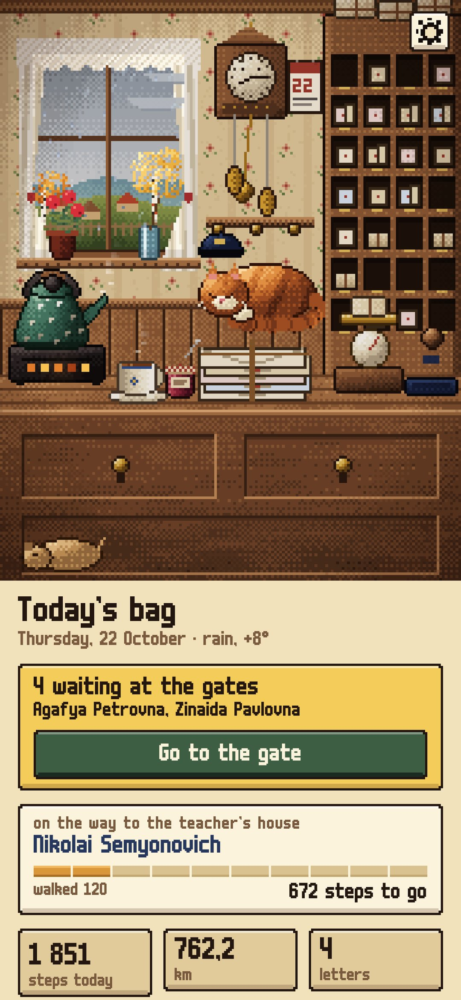
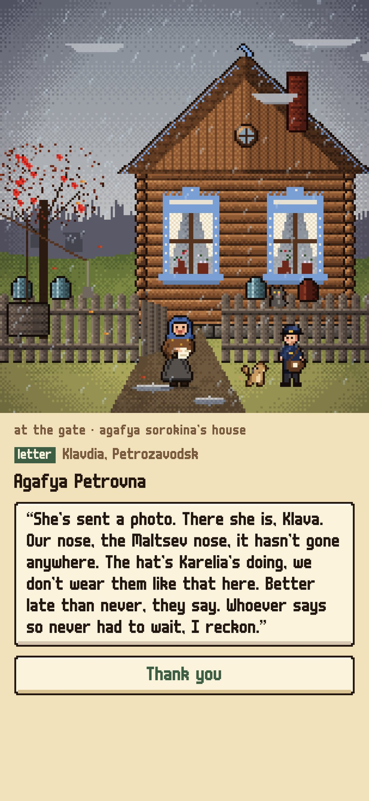
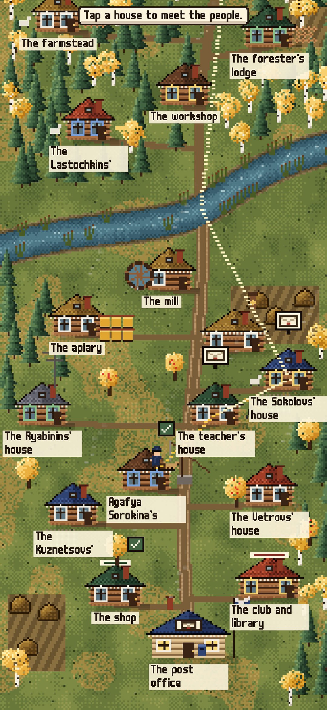
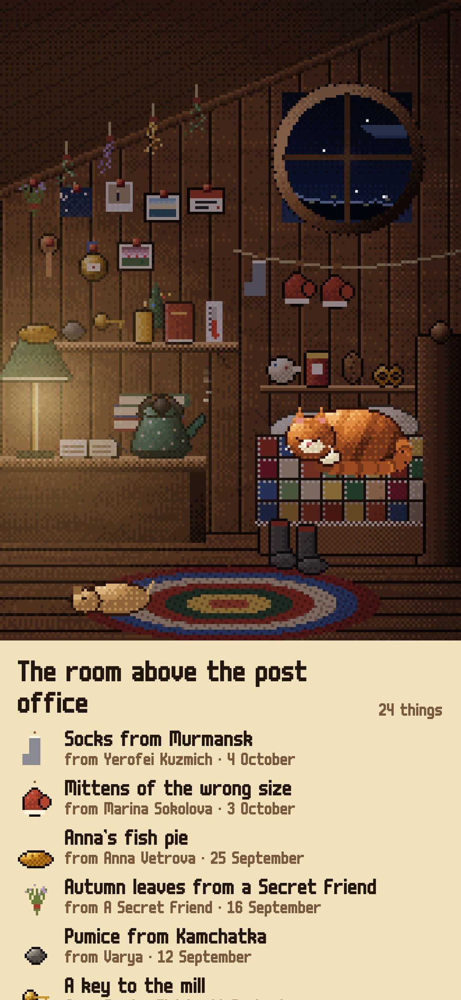
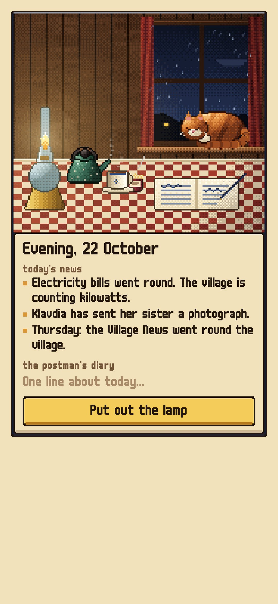

<div align="center">


# Lipovka Post

### A pedometer where your steps carry the village post.

*You are the new postman of Lipovka, a small village by the river Lipka. Every morning letters arrive at the post office, and your real steps carry the bag from house to house. You never read other people's letters: at the gate the resident opens the envelope, tells you the news, gives you a jar of jam and sometimes a reply to carry. Story by story, the lives of the village unfold over years. Free, no ads, no account.*

[](https://github.com/bigdevwhale/lipovka/actions/workflows/android.yml)
[](https://github.com/bigdevwhale/lipovka/releases/latest)


[](LICENSE)

**English** · [Русский](README.ru.md) · [Changelog](CHANGELOG.md)

    

</div>

---

## How it works

1. **The morning post.** The kettle is on, the cat Surguch is asleep on the letters, the wall clock with a cat's face shows the real time. The bag is sorted for about a usual day's walk (the median of your recent days), so a light walker and a long walker both get a full, finishable round. What doesn't fit waits on the shelf for a lighter day.
2. **Your steps are the bag.** The phone's own step counter counts even with the app closed. On the hand-drawn map the little postman walks the road to the next house; telegrams go first. Nothing is lost: steps carry over, a far letter is simply a longer walk.
3. **At the gate.** The resident reads the letter and tells you about it. Gifts go up to your room above the post office, stamps into the album, replies into tomorrow's bag.
4. **The stories.** 30 residents, 55 story arcs, 669 letters, written to last two to three years and more: a sailor's fiancée and her wedding, a widow looking for her lost sister, a teacher's former pupils, a girl writing to Ded Moroz every December and growing up, a boy catching radio voices from Antarctica, a beekeeper's live queen bee arriving by post. The postman gets letters too: a mystery each season, a pen-pal postwoman in the Urals, a bundle of letters from 1958 in the attic.
5. **And after that, forever.** The weekly newspaper, pensions, magazines, birthday cards, New Year cards, 267 everyday letters and 35 yearly village events (the autumn fair, the river freezing, Maslenitsa, the ice breaking, haymaking, cranes leaving) keep the bag full year after year.
6. **The village grows with you.** At 50 km walked the bridge is repaired and Zarechye opens across the river; then the railway halt, a lake hamlet, a weather station deep in the forest and the district town. A stray dog, Bublik, starts walking with you after the first week.
7. **The real sky.** Pick your town (optional) and Lipovka has your weather from Open-Meteo: rain on the window, snow on the roofs, fog over the river, real sunrise and sunset, the moon in its real phase. Without a town the village keeps its own seasonal weather.
8. **The evening.** The kerosene lamp, tea with jam, the day's news, one line in the postman's diary.

## Privacy

No account, no ads, no analytics. Steps, letters and the diary stay on the phone. The only network request is the weather: the chosen town's coordinates go to Open-Meteo, nothing else.

## Building

```bash
./gradlew testDebugUnitTest assembleDebug              # app.lipovka.dev, next to a real install
./gradlew assembleDebug -Pdemo                         # app.lipovka.demo, four months into the job
./gradlew testDebugUnitTest -Prender --tests '*RenderArt*' && python tools/shots.py   # screenshots and scene sheets
python tools/check_content.py                          # validates every letter, item and stamp
python tools/res.py                                    # the string resources, EN and RU
python tools/icon.py                                   # the launcher icon and the logo
```

Kotlin, Jetpack Compose, Room, DataStore, WorkManager. Every picture is pixel art drawn in code, frame by frame: the post office, the map of the countryside, every house at its gate, the people, the room, the stamps, the gifts, in every season, weather and hour. The content is TSV in `app/src/main/assets/content` (format in [docs/CONTENT.md](docs/CONTENT.md), the world in [docs/WORLD.md](docs/WORLD.md)). `GameTest` plays three years of rounds and checks the post comes every day and the stories keep going.

## License

[MIT](LICENSE). Font: m6x11 by Daniel Linssen, Cyrillic by Natto Games (free with attribution). Weather: [Open-Meteo.com](https://open-meteo.com).
