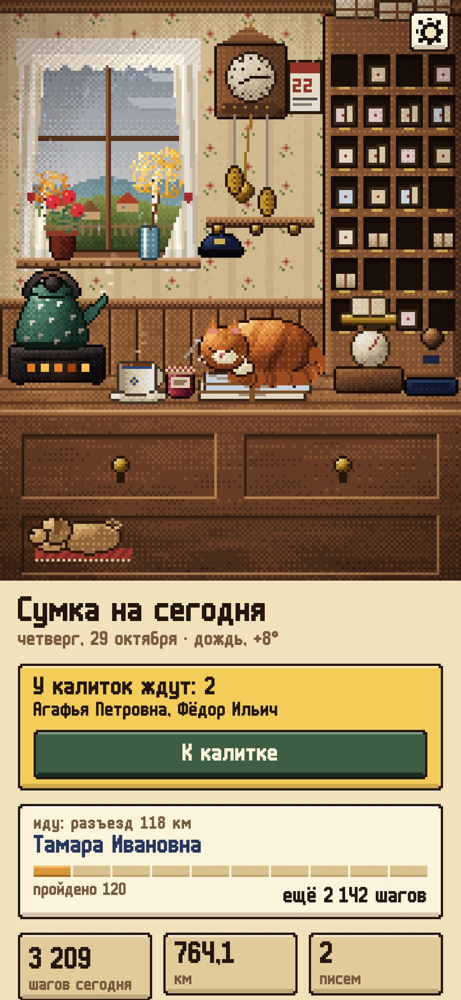
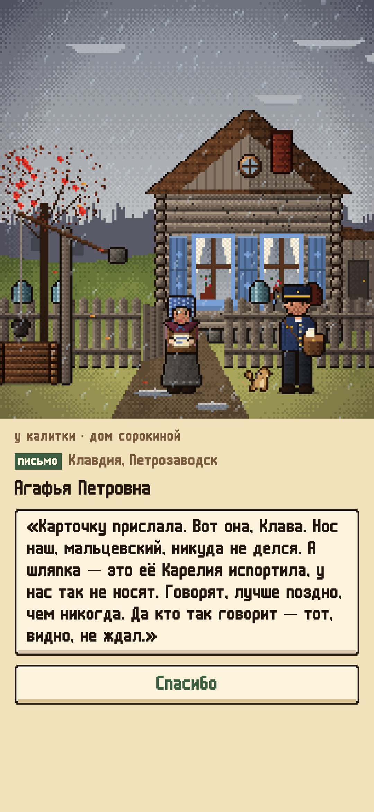
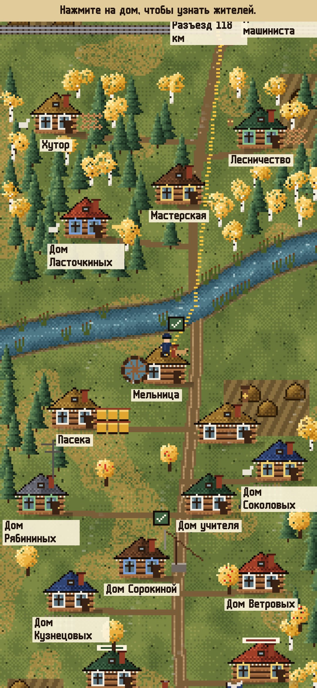
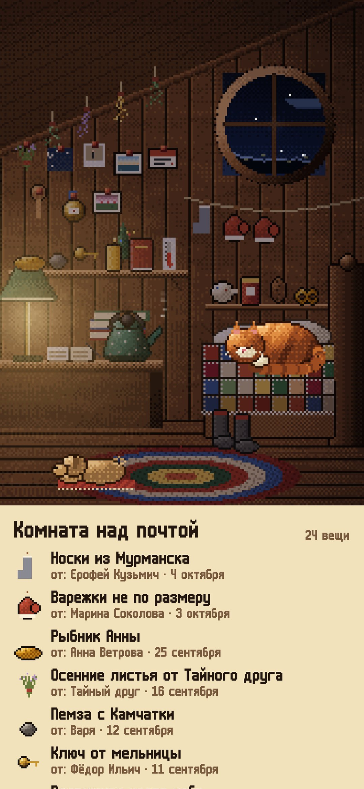
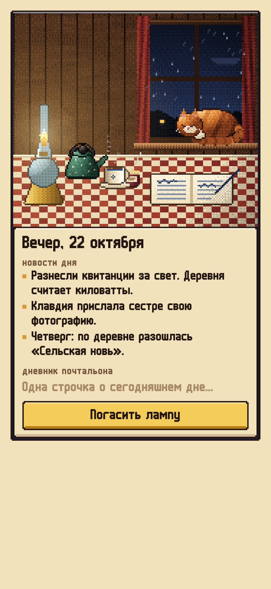

<div align="center">


# Почта в Липовке

### Шагомер, в котором ваши шаги разносят деревенскую почту.

*Вас назначили почтальоном в Липовку, маленькую деревню на реке Липке. Каждое утро на почту приходят письма, а ваши настоящие шаги несут сумку от дома к дому. Чужих писем почтальон не читает: у калитки житель сам вскрывает конверт, рассказывает новость, выносит банку варенья, а иногда даёт ответ, чтобы вы его отнесли. Письмо за письмом жизнь деревни разворачивается годами. Бесплатно, без рекламы и аккаунта.*

[](https://github.com/bigdevwhale/lipovka/actions/workflows/android.yml)
[](https://play.google.com/store/apps/details?id=app.lipovka)
[](https://github.com/bigdevwhale/lipovka/releases/latest)

[](LICENSE)

[English](README.md) · **Русский** · [Изменения](CHANGELOG.md)

    

</div>

---

## Как это устроено

1. **Утренняя почта.** Чайник на плитке, кот Сургуч спит на письмах, ходики с кошкой показывают настоящее время. Сумка собирается примерно на ваш обычный день ходьбы (по медиане последних дней), так что полную сумку можно разнести и при коротких, и при длинных прогулках. Что не поместилось, ждёт на полке более лёгкого дня.
2. **Ваши шаги — это сумка.** Телефон сам считает шаги, даже когда приложение закрыто. На нарисованной карте маленький почтальон идёт по дороге к следующему дому, телеграммы первыми. Ничего не теряется: шаги переходят на завтра, дальнее письмо — просто прогулка подлиннее.
3. **У калитки.** Житель читает письмо и рассказывает новость. Гостинцы уходят в вашу комнату над почтой, марки в альбом, ответы в завтрашнюю сумку.
4. **Истории.** 30 жителей, 55 сюжетов, 669 писем, рассчитанных на два-три года и дольше: невеста моряка и её свадьба, вдова, которая ищет потерянную сестру, ученики старого учителя, девочка, которая каждый декабрь пишет Деду Морозу и растёт, мальчик-радиолюбитель, поймавший Антарктиду, живая пчелиная матка в посылке у пчеловода. Почтальону тоже пишут: загадка каждого сезона, подруга по переписке, почтальонка с Урала, связка писем 1958 года на чердаке.
5. **А потом всегда.** Газета по четвергам, пенсия, журналы, открытки к дням рождения и Новому году, 267 повседневных писем и 35 ежегодных событий деревни (Покровская ярмарка, ледостав, Масленица, ледоход, сенокос, отлёт журавлей) наполняют сумку год за годом.
6. **Деревня растёт вместе с вами.** На 50-м километре чинят мост, и открывается Заречье. Потом разъезд с телеграфом, рыбацкие Озёрки, метеостанция в лесу и районный Городок. Через неделю прогулок за вами начинает ходить бездомный пёс Бублик.
7. **Настоящее небо.** Выберите свой город (по желанию), и в Липовке будет ваша погода из Open-Meteo: дождь на стекле, снег на крышах, туман над рекой, настоящие рассвет и закат, луна в своей фазе. Без города у деревни своя погода по сезону.
8. **Вечер.** Керосиновая лампа, чай с вареньем, новости дня, одна строчка в дневник почтальона.

## Скачать

**[Скачать в Google Play](https://play.google.com/store/apps/details?id=app.lipovka)**.

Или возьми **Lipovka.apk** в [последнем релизе](https://github.com/bigdevwhale/lipovka/releases/latest) и открой на телефоне (разреши установку из браузера или файлового менеджера, когда Android спросит).

## Приватность

Без аккаунта, рекламы и аналитики. Шаги, письма и дневник остаются в телефоне. Единственный сетевой запрос — погода: в Open-Meteo (или в MET Norway, если Open-Meteo недоступен) уходят только координаты выбранного города.

## Сборка

```bash
./gradlew testDebugUnitTest assembleDebug              # app.lipovka.dev рядом с настоящей установкой
./gradlew assembleDebug -Pdemo                         # app.lipovka.demo: четыре месяца службы
./gradlew testDebugUnitTest -Prender --tests '*RenderArt*' && python tools/shots.py   # скриншоты и листы сцен
python tools/check_content.py                          # проверка всех писем, вещей и марок
```

Kotlin, Jetpack Compose, Room, DataStore, WorkManager. Вся графика — пиксель-арт, нарисованный кодом кадр за кадром. Контент лежит в TSV в `app/src/main/assets/content` (формат в [docs/CONTENT.md](docs/CONTENT.md), мир в [docs/WORLD.md](docs/WORLD.md)).

## Лицензия

[MIT](LICENSE). Шрифт m6x11: Daniel Linssen, кириллица: Natto Games. Погода: [Open-Meteo.com](https://open-meteo.com) и [MET Norway](https://api.met.no) (CC BY 4.0).
